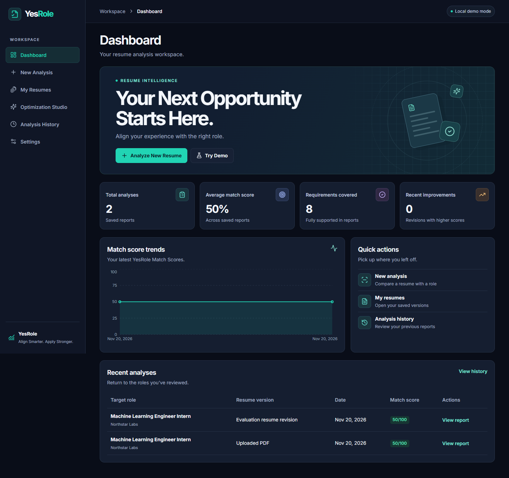
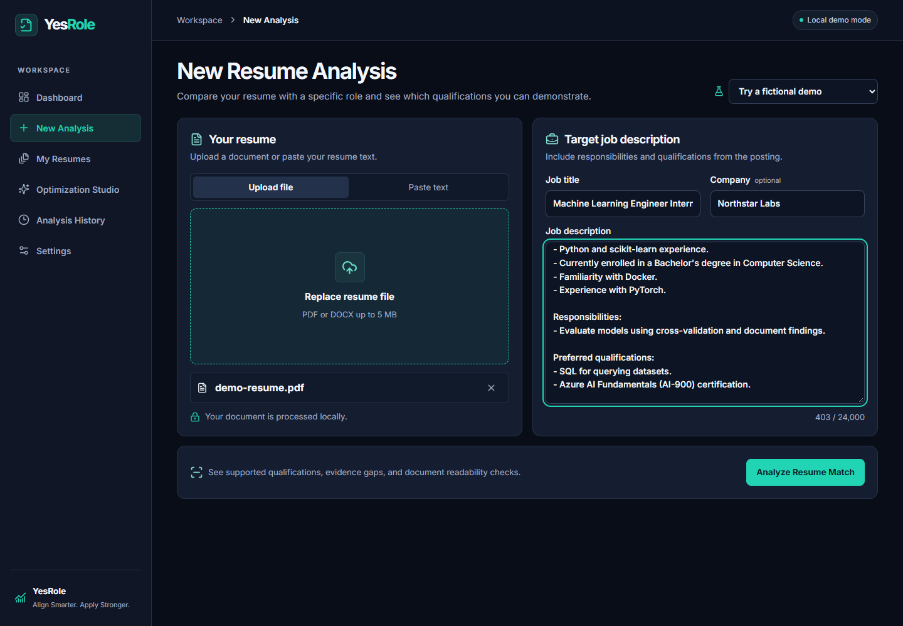
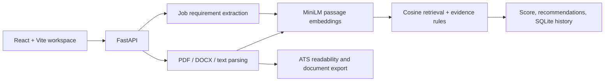

# YesRole

**Align Smarter. Apply Stronger.**

YesRole helps students, early-career developers, and job seekers show how their real experience relates to a specific job. It finds evidence in a resume for each extracted requirement, identifies gaps, and gives the applicant control over wording and export.

## Features

- Upload a PDF or DOCX up to 5 MB, paste text, or try a fictional ML Engineer, Python Developer, or Data Analyst internship scenario.
- Review the **YesRole Match Score**, weighted dimensions, requirement classifications, and quoted resume evidence.
- Inspect **ATS Readability** checks for extraction, headings, contact information, dates, and formatting.
- Edit and compare two resume versions. Accept or reject grounded suggestions and decide what to export.
- Download a text match report or a single-column, selectable-text PDF or DOCX resume.
- Save resume versions in the browser and revisit or delete reports in local analysis history.

## Screenshots

| Dashboard | New analysis |
| --- | --- |
|  |  |

[Match report and evidence explorer](docs/screenshots/match-report.png) · [Before-and-after comparison](docs/screenshots/before-after.png)

The [Stitch exports](stitch-design/) contain the original light editorial references. YesRole keeps their sidebar, form split, and results structure and applies the dark brand palette specified for the application.

## Architecture



The frontend uses React Router, TypeScript, Tailwind CSS, Inter, Lucide and Recharts. Zod validates form inputs. The backend uses FastAPI, Pydantic, PyMuPDF and python-docx. Sentence Transformers and NumPy run inference and vector comparisons, and scikit-learn reports evaluation metrics.

### NLP and evidence classification

1. Normalize document text and recognize standard headings. Split section contents into lines or short passages.
2. Extract candidate qualifications by section and phrasing. Preserve the requirement text and identify known skills and explicit priority. Unmarked requirements default to Required.
3. Encode requirements and resume passages with **sentence-transformers/all-MiniLM-L6-v2**. The CPU process loads a 384-dimensional encoder once and batches inference. A dot product between normalized embeddings yields cosine similarity.
4. Rank passages by similarity and check for explicitly named tools, aliases, negation, named credentials, education, and scoped professional experience. Related tooling can receive partial credit when relevant. Project duration alone does not substantiate professional tenure.
5. Classify each requirement **Supported**, **Partially Supported**, or **Not Evidenced**. The report explains the decision and shows the strongest relevant passage when available. Cosine similarity measures the relation between texts on a −1 to 1 scale.

### Scoring

`YesRole Match Score = round(100 × Σ(weight × dimension) / Σ(applicable weights))`

| Dimension | Base weight | Calculation |
| --- | ---: | --- |
| Required qualification coverage | 45 | Mean credit for required non-experience requirements |
| Preferred qualification coverage | 15 | Mean credit for preferred requirements |
| Semantic relevance | 20 | Mean nonnegative cosine similarity for retrieved passages, discounted by classification credit |
| Experience alignment | 15 | Mean credit for required experience requirements |
| Evidence quality | 5 | Share of requirements with some support and a concrete action in an Experience or Projects passage |

Coverage credits are 1, 0.5, and 0. Coverage categories with no items are omitted, and their weight is redistributed proportionally. Actual weights and values appear in the report. This heuristic measures how clearly the supplied resume supports the supplied job description. ATS readability is displayed separately and has no effect on this score. Hiring outcomes depend on employer processes that YesRole does not measure.

## Run on Windows with PowerShell

Use **Python 3.11 or 3.12** and **Node.js 22.12+** with npm. Run setup from the project root.

```powershell
python -m venv .venv
.\.venv\Scripts\python.exe -m pip install --upgrade pip
.\.venv\Scripts\python.exe -m pip install torch==2.15.0 --index-url https://download.pytorch.org/whl/cpu
.\.venv\Scripts\python.exe -m pip install -r backend\requirements-dev.txt
Push-Location backend
..\.venv\Scripts\python.exe -m app.download_model
Pop-Location
Push-Location frontend
npm.cmd ci
Pop-Location
```

After setup, open localhost with the launcher or run the two development services in separate terminals.

```powershell
powershell -NoProfile -ExecutionPolicy Bypass -File .\Run-YesRole.ps1
```

If Node is installed outside PATH, set `YESROLE_NODE_EXE` to the absolute path to `node.exe` before launching.

For the VS Code task and Azure Container Apps deployment, see [Run and deploy YesRole](DEPLOY.md).

For publishing to GitHub, free teacher demo links, and a plain-language explanation of the model, see [Show YesRole to your teacher](TEACHER_GUIDE.md).

```powershell
# Terminal 1 from the project root
Set-Location backend
..\.venv\Scripts\python.exe -m uvicorn app.main:app --host 127.0.0.1 --port 8000 --no-access-log
```

```powershell
# Terminal 2 from the project root
Set-Location frontend
npm.cmd run dev
```

Open [YesRole on localhost](http://127.0.0.1:5173) or [FastAPI docs](http://127.0.0.1:8000/docs). The Vite development server proxies `/api` to FastAPI. Copy `.env.example` to `.env` at the project root for optional backend settings. The model command downloads to `.runtime/minilm`. When offline, set `YESROLE_OFFLINE=true` or point `YESROLE_MODEL_PATH` at a complete local model directory. If model loading fails, verify the downloaded files or rerun `python -m app.download_model` from `backend`.

The frontend production build is `frontend/dist`. A reverse proxy can serve that folder with an index fallback for React routes and forward `/api` to FastAPI. For a separate frontend origin, set `VITE_API_URL` at build time and configure `YESROLE_CORS_ORIGINS` and `YESROLE_ALLOWED_HOSTS` for the deployment. Keep this single-user version on loopback or behind authenticated access.

### Optional local AI assistance

Set `YESROLE_LLM_URL` and `YESROLE_LLM_MODEL` for a local OpenAI-compatible chat endpoint, then restart the backend. Studio offers an explicit opt-in action to send the target requirements and proposed rewrites to that local process. The assistant ranks IDs from the deterministic proposals. It cannot add new text to the draft, and the user applies every edit. The core analysis, editor, and exports work without an LLM. Hosted LLM providers and unconstrained generative rewriting are outside this version.

## Tests and evaluation

```powershell
# From the project root
Push-Location backend
$env:YESROLE_TEST_MODEL = "1"
$env:YESROLE_OFFLINE = "true"
..\.venv\Scripts\python.exe -m pytest -q
..\.venv\Scripts\python.exe -m app.evaluate
Pop-Location
Push-Location frontend
npm.cmd test
npm.cmd run build
Pop-Location
```

The backend suite covers invalid uploads, PDF and DOCX round trips, requirement parsing, mismatch and negation cases, duration and qualification checks, scoring, recommendation rules, API validation, and real MiniLM inference. The frontend tests cover routing, the demo form, and filtering evidence in reports. See [evaluation notes](backend/evaluation/README.md) for real-model results and the confusion matrix.

The Windows verification run passed 34 backend tests, 2 frontend tests, and the production build. In Chrome, the ML internship PDF supported four of seven requirements and scored 50/100 both before and after a wording edit. An unrelated budgeting resume scored 0/100 with zero supported requirements. The browser run also verified suggestion undo, saved versions, mobile navigation, and both exports by re-parsing their downloaded content.

## Privacy and limitations

- The backend stores saved report excerpts and recommendations in a local SQLite database. Analysis History can delete each report. Raw uploads and full source documents are not retained on the server. Explicitly saved resume versions use local storage. Analysis-to-editor working text uses session storage.
- The UI treats contact and date format detection as heuristics. Image-only resumes require a text-based alternative. Complex columns, tables, uncommon headings, and multilingual layouts can reduce extraction quality.
- Requirement extraction is English-oriented and bounded to 45 items, and retrieval uses up to 450 passages. A limited skill taxonomy, unrecognized section headings, and ambiguous qualification wording can produce partial or missed matches. Professional durations generally require an explicit qualified claim. Inspect evidence before relying on a classification.
- The app is designed for one local user. It has no account or role permissions and does not expose an official ATS compatibility score. Resume text never goes to a hosted inference API in the core workflow.

## Microsoft Azure AI Fundamentals alignment

YesRole demonstrates document processing, NLP, embeddings, local AI inference, evidence classification, labeled model evaluation, and responsible AI practices such as user review and interpretable evidence. [Microsoft Learn AI-901 study guide](https://learn.microsoft.com/en-us/credentials/certifications/resources/study-guides/ai-901)

A future deployment could put Azure Document Intelligence behind the parser interface for richer layout extraction and use Azure AI Search with a Foundry embedding deployment for a consented retrieval workload. YesRole currently runs all matching locally. [Azure Document Layout skill](https://learn.microsoft.com/en-us/azure/search/cognitive-search-skill-document-intelligence-layout) · [Azure embedding and vectorization](https://learn.microsoft.com/en-us/azure/search/vector-search-how-to-generate-embeddings)

Portfolio follow-up work includes independent evaluation on consented resumes, more document formats and languages, accessibility testing with assistive technology, and authentication and retention controls for a hosted build.

See the [two-minute demo and viva guide](DEMO_GUIDE.md).

